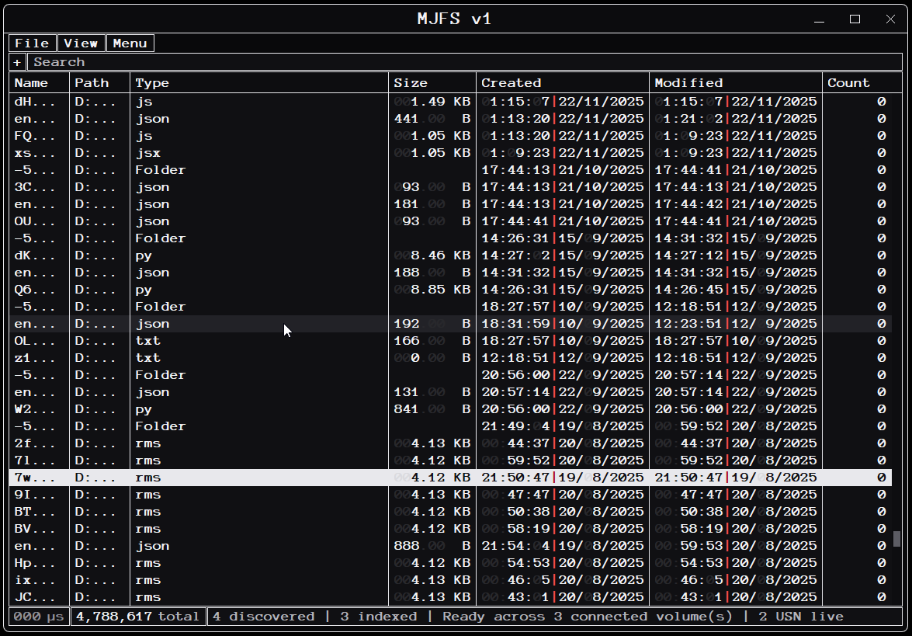
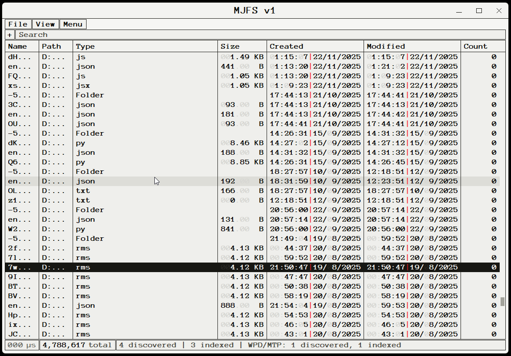
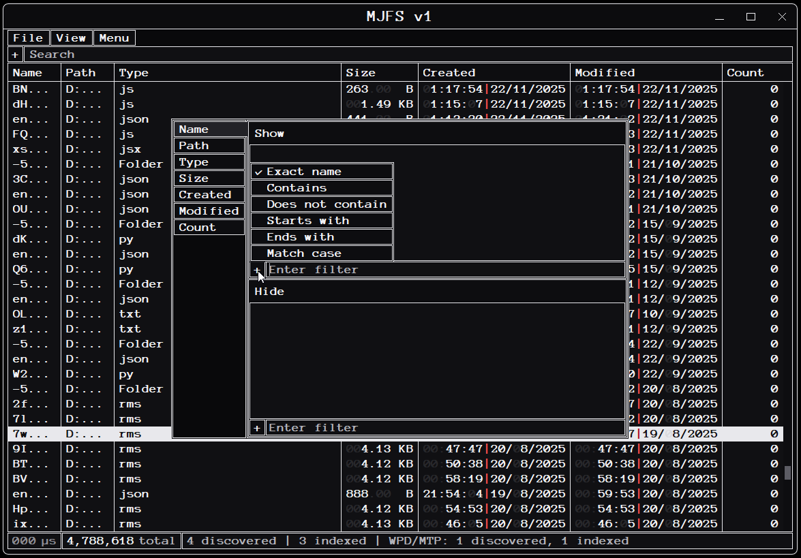
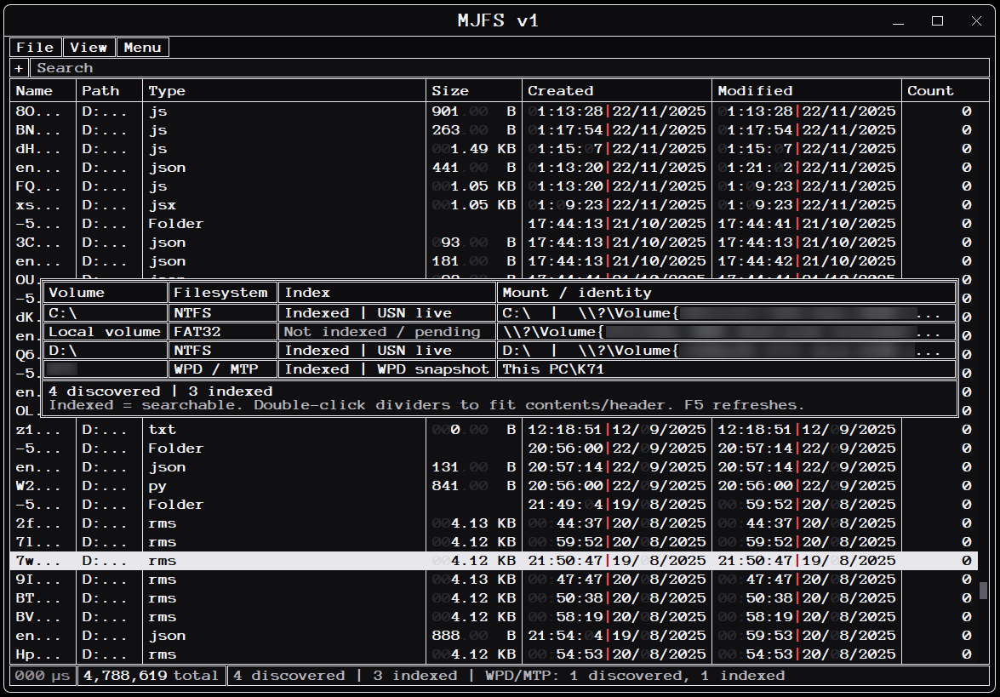

# MJFS v1.1

**Native file discovery and search for Windows x64.** MJFS combines a compact Win32 interface with indexed volume searching, change tracking where supported, and metadata filtering.

<p align="center">
  <a href="https://github.com/MarceloAlejandroJorquera/MJFS/releases/latest"></a>
  <a href="docs/BUILD.md"></a>
  <a href="docs/DISTRIBUTION_v1.1.md"></a>
  <a href="docs/PORTABILITY.md"></a>
</p>

## Screenshots

| Search — dark | Search — inverted colors |
| :--: | :--: |
|  |  |

| Filter options | Volume discovery |
| :--: | :--: |
|  |  |

## Features

- Native Windows x64 interface with query results, responsive table navigation and column sorting.
- Runtime discovery of NTFS, FAT32 and supported WPD/MTP sources.
- NTFS/USN-based updates where available; capability, permission, and device-dependent fallbacks.
- Search and filters by file/path/type, size, Created/Modified date and wildcard patterns.
- Live-oriented table and compact filter/volume controls, with dark and inverted themes.

Features depend on permissions, device behavior, filesystem, and host configuration. Cross-host certification must not be inferred from tests on one machine.

## Download

Download the single asset **[`MJFSv1.1.zip`](https://github.com/MarceloAlejandroJorquera/MJFS/releases/tag/v1.1)** from the [Releases page](https://github.com/MarceloAlejandroJorquera/MJFS/releases). The ZIP contains exactly two root-level files:

- `MJFSv1.1.exe` — the user-facing portable GUI executable.
- `SHA256SUMS.txt` — the SHA-256 checksum of that executable.

Extract both files into one directory. In Windows PowerShell 5.1, verify the EXE before launching:

```powershell
$lines = @(Get-Content -LiteralPath .\SHA256SUMS.txt)
if ($lines.Count -ne 1 -or $lines[0] -cnotmatch '^[0-9a-f]{64}  MJFSv1\.1\.exe$') {
    throw 'Invalid SHA256SUMS.txt'
}
$expected = $lines[0].Substring(0,64)
$actual = (Get-FileHash -LiteralPath .\MJFSv1.1.exe -Algorithm SHA256).Hash.ToLowerInvariant()
if ($actual -cne $expected) { throw 'MJFSv1.1.exe SHA256 mismatch' }
.\MJFSv1.1.exe
```

**Service architecture:** MJFS v1.1 ships only one user-facing EXE. It embeds the broker payload as a resource and can install/update a separate secured service executable under ProgramData for Windows Service Control Manager. The broker intermediate and installed service executable are not distributed as extra ZIP members. Service operations can require elevation and are not a claim of zero local installation footprint.

## Technical information

- [Build requirements](docs/BUILD.md)
- [Release verification](docs/VERIFY.md)
- [Portability and limitations](docs/PORTABILITY.md)
- [Distribution notices](docs/DISTRIBUTION_v1.1.md)
- [v1.1 release notes](docs/RELEASE_NOTES_v1.1.md)
- [Changelog](CHANGELOG.md)

The application is built with MSVC for x64 Release. UI font material is embedded in the executable subject to applicable licensing; font files are not release assets. The public documentation repository does not itself provide the private production source tree.
